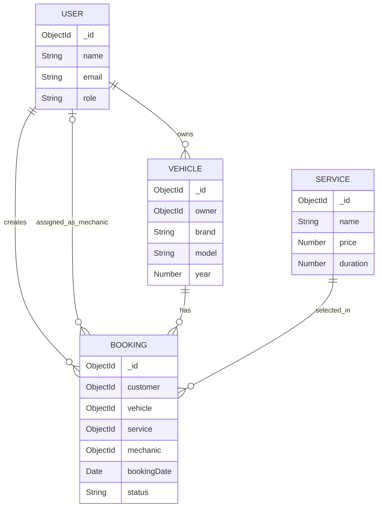

# AutoFix Database Schema

## 1. User Collection
- _id: ObjectId (Primary Key)
- name: String
- email: String (Unique)
- password: String
- phone: String
- role: String (customer, mechanic, admin)
- createdAt: Date
- updatedAt: Date

## 2. Vehicle Collection
- _id: ObjectId (Primary Key)
- owner: ObjectId (Reference: User)
- brand: String
- model: String
- year: Number
- registrationNumber: String (Unique)
- color: String
- createdAt: Date
- updatedAt: Date

## 3. Service Collection
- _id: ObjectId (Primary Key)
- name: String
- description: String
- price: Number
- duration: Number (Minutes)
- isAvailable: Boolean
- createdAt: Date
- updatedAt: Date

## 4. Booking Collection
- _id: ObjectId (Primary Key)
- customer: ObjectId (Reference: User)
- vehicle: ObjectId (Reference: Vehicle)
- service: ObjectId (Reference: Service)
- mechanic: ObjectId (Reference: User)
- bookingDate: Date
- status: String
- notes: String
- createdAt: Date
- updatedAt: Date

## 5. Entity Relationships

