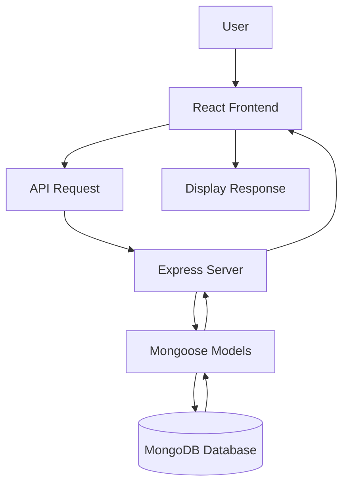

# AutoFix System Architecture

## Architecture Overview

AutoFix follows the MERN stack architecture.

## Technologies

- Frontend: React.js with Vite
- Backend: Node.js and Express.js
- Database: MongoDB
- ODM: Mongoose

## System Flow

## Working

1. User interacts with the React frontend.
2. Frontend sends API requests to the Express backend.
3. Express handles incoming requests.
4. Mongoose models define and manage database documents.
5. MongoDB stores application data.
6. Backend sends responses to the frontend.

## Backend Structure

- config: Database configuration.
- models: Database schemas.
- controllers: Request handling logic (planned).
- routes: API routes (planned).
- middleware: Request middleware (planned).

## Frontend Structure

- components: Reusable UI components.
- pages: Application pages.
- services: API communication.
- assets: Images and static files.
